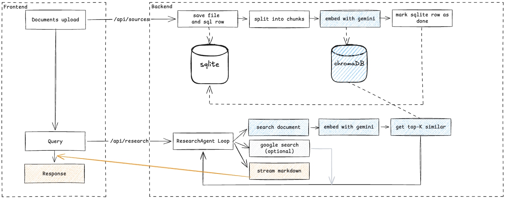

# Research assistant

Full-stack agent that uses RAG for answering question: upload text sources, ask questions, stream markdown answers grounded in your files and (optionally) Google Search.

## 1. Setup and run

### Prerequisites

- [uv](https://docs.astral.sh/uv/) (Python 3.12+)
- Node.js 22+ (local frontend only)
- Docker + [Docker Compose](https://docs.docker.com/compose/) (optional)
- A [Gemini API key](https://aistudio.google.com/apikey)

### Configuration

From the repository root:

```sh
cp .env.example .env
```

Edit `.env` and set `GEMINI_API_KEY`. Other variables have sensible defaults (model, chunk size, `TOP_K`, `GOOGLE_SEARCH_ENABLED`). The backend reads **only** the repo-root `.env`.

Persistent data (uploads, SQLite, Chroma) lives under `data/` (gitignored). In Docker, `./data` is mounted into the backend container.

### Local development

```sh
make run-local
```

This starts the API on `http://localhost:8787` and the Vite UI on `http://localhost:5173`.

Individual services:

```sh
make run-backend-local   # backend only
make run-frontend-local  # frontend only (cd frontend && npm install first)
```

### Docker

```sh
make run    # docker compose up
make stop   # docker compose down
```

Open the UI at `http://localhost:5173`. The frontend container sets `VITE_API_BASE_URL=http://localhost:8787` so the browser talks to the published backend port on the host.

### Quality checks

```sh
make test   # pytest in backend/
make lint   # ruff check --fix
make check  # test + lint
```

---

## 2. Architecture and design



**Frontend** — Provided Vite app: multipart uploads, JSON research requests, reads the research response as a streamed body and appends markdown chunks.

**Backend** — FastAPI with CORS for the dev UI, plain-text error bodies, and `StreamingResponse` for research.

**Ingestion** — Each upload gets a UUID, a row in SQLite (`processing` → `ready` / `failed`), the raw file under `data/uploads/`, word-based chunks, Gemini embeddings with task type `RETRIEVAL_DOCUMENT`, and an upsert into a single Chroma collection (cosine space, vectors supplied by us—not Chroma’s built-in embedder).

**Retrieval** — When the model calls `search_documents`, the backend embeds the query with `RETRIEVAL_QUERY`, runs top-`k` similarity search, and returns formatted chunks with filename and chunk index.

**Agent loop** — Gemini streams the answer. `search_documents` is handled manually (`automatic_function_calling` disabled) so we control when retrieval runs and can stream tokens to the client. Up to `MAX_TURNS` tool rounds per request.

**External sources** — With `GOOGLE_SEARCH_ENABLED=true` (default), the model also gets the `google_search` tool. Grounding metadata from the stream is collected and a **Web sources** footer is appended when the turn finishes without another document search. Uploads are cited as `[filename:chunk_index]`; web results use `[title](url)` in the prompt.

**Parallelism** — Multiple files in one upload are read and ingested concurrently (`asyncio.gather`). Embedding runs in batches (`EMBED_BATCH`) with a small concurrency cap (`EMBED_WORKERS`) so large files do not serialize on the network.

**Errors** — `IngestError` (e.g. invalid UTF-8, empty file) → HTTP 400 and `failed` in SQLite. Validation and unexpected API errors map to 4xx/5xx. Research failures can also appear as text in the stream so the UI still shows a partial answer when possible.

### Out of scope / not yet implemented

Planned or typical next steps we did not ship:

| Area | Idea |
|------|------|
| **Dedup** | Content-hash uploads and skip re-embedding identical files (TODO in code). |
| **Retries** | Exponential backoff for Gemini embed/generate and transient Chroma errors. |
| **Upload queue** | Background worker so large files do not block the HTTP request (bonus in the brief). |
| **PDF / Office** | `docling` is a dependency but unused; today only UTF-8 text uploads. |
| **Reranking** | Cross-encoder or LLM rerank on top-`k` before context injection. |
| **Hybrid retrieval** | BM25 + vectors, or metadata filters (by `doc_id` / filename). |
| **Observability** | Structured logs, trace IDs, Langfuse/OpenTelemetry for embed/latency/cost per request. |
| **Eval harness** | Golden Q&A sets, retrieval recall@k, citation match rate (see below). |
| **Safety / ops** | Rate limits, max upload size, auth, idempotent multi-file upload (all-or-nothing). |

More detail on HTTP shapes lives in [backend/README.md](backend/README.md). Frontend API notes: [frontend/README.md](frontend/README.md).

---

## 3. Evaluating and improving the agent

Evaluation should separate **retrieval** (did we fetch the right chunks?) from **generation** (did the answer use them correctly?).

**Retrieval metrics**

- Build a small set of `(file, question, expected_chunk_ids or keywords)` cases.
- After `search_documents`, check recall@k: is the gold chunk in the top-`k` results?
- Sweep `CHUNK_WORDS`, `CHUNK_OVERLAP`, and `TOP_K` and compare recall—cheap before tuning prompts.

**Answer quality**

- **Citation accuracy:** Parse citations in the output; verify filename/chunk index exists and the quoted fact appears in that chunk text.
- **Faithfulness:** LLM-as-judge or human rubric: “every factual claim supported by retrieved text or cited web URL.”
- **Hallucination rate** on “not in corpus” questions—should abstain or use web, not fabricate upload citations.

**End-to-end**

- Fixed prompts run on every PR (`make test` covers chunking, parallel ingest, and tool wiring with mocks).
- Periodic manual or scripted runs against real Gemini with recorded fixtures (VCR) to catch API/schema drift.
- Track latency (time-to-first-token, ingest duration) and token/cost per research session.

**Why this matters for RAG**

Bad retrieval cannot be fixed by a better prompt; good retrieval with a weak cite instruction still hallucinates. Measuring both lets you decide whether to invest in chunking, reranking, hybrid search, or system-prompt/tool design—and whether web grounding helps or distracts for your domain.

Improvement loop: log retrieval results + final answer → label failures → fix the layer that failed (embed model, chunk size, k, reranker, or agent instructions) → re-run the golden set.
